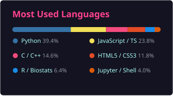

<div align="center">

# 🧬 Suleiman Hajizadeh
### Biology Graduate | Bioinformatics | Computational Structural Biology | Scientific Computing


[-10B981?style=flat-square&logo=target&logoColor=white)](https://rosalind.info/users/ShlomoHajizadeh/)
[](https://suleimancertificates.github.io/)
[](https://wcu.edu.az/en/)
[](https://github.com/Institute-of-Molecular-Biology-IMB)

<p align="center">
  <em>Developing reproducible computational and statistical methods for protein structure validation, macromolecular geometry analysis, and transcriptomic workflows.</em>
</p>

</div>

---

### 👨🏻‍💻 Academic Profile & Affiliations
- 🎓 **B.Sc. in Biology (Final-Year Undergraduate / Graduate Track)** at **Western Caspian University (WCU)**.
- 🔬 **Bioinformatics Research Trainee & Project Collaborator** affiliated with computational biology projects at the **Institute of Molecular Biology and Biotechnologies (IMBB / AR ETN MBİ)** and **Western Caspian University**.
- 🧪 **Student Initiative Founder:** **[CarboxMol Bioinformatics Club](https://carboxmol-bioinformatics-club.github.io/)** — a student-led bioinformatics and structural biology platform established at Western Caspian University.
- ⚙️ **Scientific Software Developer (In Active Development):** Creator of **[Carbox](https://github.com/project-carbox)** (macromolecular coordinate & stereochemical geometry engine) and **[CarboxMol](https://github.com/carboxmol)** (3D macromolecular visualization workspace for research & education).
- 🎯 **Algorithmic Bioinformatics**: Solved **284 / 284 (100%)** bioinformatics algorithmic problems on [Rosalind](https://rosalind.info/users/ShlomoHajizadeh/).

---

### 📄 Publications, Manuscripts & Technical Outputs

*Categorized transparently by publication venue and peer-review status:*

| Work / Title | Category & Status | Identifier / Venue |
| :--- | :--- | :--- |
| **AquaMind-AI: An Intelligent IoT and Machine Learning Framework for Closed-Loop Smart Aquaponics** | **Published University Journal Article** *(Peer-reviewed)* | *Research Journal of Adaptive Agriculture and Aquaculture* (2026) · [DOI: 10.54414/ADXC7547](https://rjaaa.wcu.edu.az/articledetail/71) |
| **Role of *CYP1A1* Gene Polymorphisms in Prostate Cancer Development: Bioinformatic and Epidemiological Review** | **Author Review Manuscript / Preprint** *(Non-indexed preprint)* | Zenodo / ResearchGate (2026) · [ResearchGate Full Text](https://www.researchgate.net/publication/403142792) |
| **From Transcriptomics to Protein Structure: Exploring AKT1 in Triple-Negative Breast Cancer Using AlphaFold2 & Experimental PDB Validation** | **Computational Research Project & Technical Article** | [Medium Technical Article](https://medium.com/@suleyman.hacizade1/from-transcriptomics-to-protein-structure-exploring-akt1-in-triple-negative-breast-cancer-using-db6a5a3b17ce) & [GitHub Validation Suite](https://github.com/SuleimanComputationalStructuralBiology) (2026) |
| **Reproducible Bulk & Single-Cell RNA-Seq Pipeline (TNBC Cohort)** | **Open-Source Reproducible Workflow** | [GitHub Repository](https://github.com/SuleimanHajizadeh/Bioinformatics-analysis) (`Snakemake`, `HISAT2`, `featureCounts`, `DESeq2`) |
| **Carbox & CarboxMol** | **Scientific Software Under Active Development** | [Carbox Engine](https://github.com/project-carbox) · [CarboxMol Workspace](https://github.com/carboxmol) |

---

### 🛠️ Technical Skills (Three-Tier Evidence Classification)

| Evidence Tier | Methods, Tools & Technologies | Verification / Evidence |
| :--- | :--- | :--- |
| **1. Demonstrated**<br>*(Backed by public source code, unit tests & reproducible outputs)* | **Python**, **R**, **Biopython**, **PDB/mmCIF Coordinate Parsing**, **Protein Geometry Validation** (Bond lengths/angles, $\phi/\psi/\omega$ dihedrals, Ramachandran statistics, steric clashscore, Kabsch $\text{C}_\alpha$ RMSD), **Bulk RNA-Seq Workflows** (`Snakemake`, `FastQC`, `Trimmomatic`, `HISAT2`, `featureCounts`, `DESeq2`), **Phylogenetics** (`JC69`/`K2P`, Neighbor-Joining), **Time-Series ML Evaluation** (`Scikit-Learn`, walk-forward validation), **Rosalind** (284/284) | Verified across `carbox`, `SuleimanComputationalStructuralBiology`, `SuleimanBioinformaticsAnalysis`, and `AquaMindAI` repositories |
| **2. Working Knowledge**<br>*(Practical hands-on usage in projects & coursework)* | **PyMOL**, **Coot**, **UCSF ChimeraX**, **AlphaFold2** (`pLDDT`/`PAE` interpretation), **AutoDock Vina**, **GROMACS** (solvation & MD setup), **Seurat** (scRNA-seq QC & clustering), **FastAPI**, **JavaScript/Node.js**, **Git**, **Linux/Bash**, **Docker** | Used in structural modeling workflows, virtual lab scripts, and web portals |
| **3. Learning & Active Focus**<br>*(2026–2027 Research Roadmap)* | **Experimental Macromolecular Refinement & Validation** (`REFMAC5`, `AceDRG`, `ProSMART`, `Servalcat`, `CCP4` suite), **Bayesian Statistical Modelling** for X-ray Crystallography & Cryo-EM density fitting, **C++ Scientific Computing** | Primary focus area for postgraduate research preparation in Computational Structural Biology |

---

### 🏛️ Flagship Ecosystems & Live Portals

| Platform / Organization | Focus Area | Live Link |
| :--- | :--- | :---: |
|  **[carboxmol](https://github.com/carboxmol)** | CarboxMol molecular structure manipulation & computation suite | [🌐 Portal](https://carboxmol.github.io/) |
|  **[CarboxMol-Bioinformatics-Club](https://github.com/CarboxMol-Bioinformatics-Club)** | Academic research club, catalytic carboxyl dyads & structural genomics | [🌐 Portal](https://carboxmol-bioinformatics-club.github.io/) |
|  **[CarboxMol-Virtulab](https://github.com/CarboxMol-Virtulab)** | Virtual laboratory platform for macromolecular structural modeling | [🌐 Portal](https://carboxmol-virtulab.github.io/) |
|  **[project-carbox](https://github.com/project-carbox)** | Core algorithmic framework for carboxyl dyad detection & analysis | [🌐 Portal](https://project-carbox.github.io/) |
|  **[Institute-of-Molecular-Biology-IMB](https://github.com/Institute-of-Molecular-Biology-IMB)** | AR ETN MBİ institutional research & bioinformatics projects | [🌐 Portal](https://institute-of-molecular-biology-imb.github.io/) |
|  **[SuleimanComputationalStructuralBiology](https://github.com/SuleimanComputationalStructuralBiology)** | AlphaFold2, AutoDock Vina, mmCIF pipelines & 41-topic structural wiki | [🌐 Portal](https://suleimancomputationalstructuralbiology.github.io/) |
|  **[SuleimanRosalindBioinformatics](https://github.com/SuleimanRosalindBioinformatics)** | 284/284 solved genomic & algorithmic challenges on Rosalind | [🌐 Portal](https://suleimanrosalindbioinformatics.github.io/) |
|  **[SuleimanBiopythonPractised](https://github.com/SuleimanBiopythonPractised)** | Programmatic sequence engine, ANOVA biostats & docking analytics | [🌐 Portal](https://suleimanbiopythonpractised.github.io/) |
|  **[SuleimanBioinformatics](https://github.com/SuleimanBioinformatics)** | Central computational biology algorithms & pipeline repositories | [🌐 Portal](https://suleimanbioinformatics.github.io/) |
|  **[SuleimanBioinformaticsAnalysis](https://github.com/SuleimanBioinformaticsAnalysis)** | High-throughput omics data processing & statistical workflows | [🌐 Portal](https://suleimanbioinformaticsanalysis.github.io/) |
|  **[SuleimanMEGAMolecularEvolutionaryTree](https://github.com/SuleimanMEGAMolecularEvolutionaryTree)** | Phylogenetic reconstructions, evolutionary distance matrices & trees | [🌐 Portal](https://suleimanmegamolecularevolutionarytree.github.io/) |
|  **[SuleimanCertificates](https://github.com/SuleimanCertificates)** | 32+ verified academic credentials backed by a Node.js REST API | [🌐 Portal](https://suleimancertificates.github.io/) |
|  **[SuleimanHolbertonComputerScience](https://github.com/SuleimanHolbertonComputerScience)** | Low-level programming, data structures, algorithms & systems | [🌐 Portal](https://suleimanholbertoncomputerscience.github.io/) |
|  **[SuleimanHTMLCSSJSanimationgallery](https://github.com/SuleimanHTMLCSSJSanimationgallery)** | Interactive scientific, molecular & web frontend animation gallery | [🌐 Portal](https://suleimanhtmlcssjsanimationgallery.github.io/) |
|  **[AquaMindAI](https://github.com/AquaMindAI)** | AI-driven biosensing & computational systems for aquaculture | [🌐 Portal](https://aquamindai.github.io/) |
|  **[InvestArea](https://github.com/InvestArea)** | Quantitative financial analytics & automated algorithmic models | [🌐 Portal](https://investarea.github.io/) |
|  **[Kripto-Kurs](https://github.com/Kripto-Kurs)** | Educational platform for cryptographic systems & decentralized finance | [🌐 Portal](https://kripto-kurs.github.io/) |
|  **[SuleimanIELTS](https://github.com/SuleimanIELTS)** | Academic English proficiency mastery resources & document archive | [🌐 Portal](https://suleimanielts.github.io/) |

---

### 🛠️ Scientific & Technical Stack

```
🧬 Structural & Bio   │ CarboxMol • Coot • PyMOL • ChimeraX • AlphaFold2 • AutoDock Vina • Biopython • MEGA • BLAST
🧠 Machine Learning   │ PyTorch • TensorFlow • Scikit-Learn • NumPy • Pandas • SciPy • Math for ML
💻 Dev & Systems      │ Python • R • C/C++ • JavaScript • Node.js • Linux/Bash • Git • Docker
```

---

### 📊 GitHub Activity & Analytics

<div align="center">




<br/>


</div>

---

### 📬 Connect

<div align="center">

[](mailto:suleyman.hacizade.232bioing@wcu.edu.az)
[](mailto:suleyman.hacizade1@gmail.com)
[](https://rosalind.info/users/ShlomoHajizadeh/)
[](https://wcu.edu.az/en/)
[](https://github.com/Institute-of-Molecular-Biology-IMB)

<br/>

<sub>🧬 Designed for Computational Biology & Open Science | © Suleiman Hajizadeh</sub>

</div>
