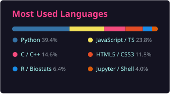

# Suleiman Hajizadeh
### Biology Graduate | Bioinformatics | Computational Structural Biology | Scientific Computing

[-10B981?style=flat-square&logo=target&logoColor=white)](https://rosalind.info/users/ShlomoHajizadeh/)

  <em>Developing computational and statistical methods for macromolecular structure validation, protein geometry analysis, and transcriptomic workflows.</em>

---

### Academic Profile & Affiliations

- **B.Sc. in Biology** at **Western Caspian University (WCU)**.
- **Bioinformatics Research Trainee & Project Collaborator** affiliated with computational biology projects at the **Institute of Molecular Biology and Biotechnologies (IMBB / AR ETN MBİ)** and **Western Caspian University**.
- **Student Initiative Founder**: **[CarboxMol Bioinformatics Club](https://carboxmol-bioinformatics-club.github.io/)**, a student-led bioinformatics and structural biology platform established at Western Caspian University.
- **Scientific Software Developer**: Creator of **[Carbox](https://github.com/project-carbox)** (macromolecular coordinate and stereochemical geometry engine) and **[CarboxMol](https://github.com/carboxmol)** (3D macromolecular visualization workspace for research and education).
- **Algorithmic Bioinformatics**: Solved **284 / 284 (100%)** bioinformatics challenges on [Rosalind](https://rosalind.info/users/ShlomoHajizadeh/).

---

### Publications & Manuscripts

| Work / Title | Category & Status | Venue / Link |
| :--- | :--- | :--- |
| **AquaMind-AI: An Intelligent IoT and Machine Learning Framework for Closed-Loop Smart Aquaponics** | Journal Article *(Peer-reviewed)* | *Research Journal of Adaptive Agriculture and Aquaculture* (2026), [DOI: 10.54414/ADXC7547](https://rjaaa.wcu.edu.az/articledetail/71) |
| **Role of *CYP1A1* Gene Polymorphisms in Prostate Cancer Development: Bioinformatic and Epidemiological Review** | Review Preprint | Zenodo / ResearchGate (2026), [ResearchGate Full Text](https://www.researchgate.net/publication/403142792) |
| **From Transcriptomics to Protein Structure: Exploring AKT1 in Triple-Negative Breast Cancer Using AlphaFold2 & Experimental PDB Validation** | Technical Project & Article | [Medium Article](https://medium.com/@suleyman.hacizade1/from-transcriptomics-to-protein-structure-exploring-akt1-in-triple-negative-breast-cancer-using-db6a5a3b17ce), [GitHub Repository](https://github.com/SuleimanComputationalStructuralBiology) (2026) |
| **Reproducible Bulk & Single-Cell RNA-Seq Pipeline (TNBC Cohort)** | Reproducible Workflow | [GitHub Repository](https://github.com/SuleimanHajizadeh/Bioinformatics-analysis) (`Snakemake`, `HISAT2`, `featureCounts`, `DESeq2`) |
| **Carbox & CarboxMol** | Scientific Software | [Carbox Engine](https://github.com/project-carbox), [CarboxMol Workspace](https://github.com/carboxmol) |

---

### Technical Skills

- **Computational Structural Biology & Biomolecular Modeling**: PDB/mmCIF coordinate parsing, macromolecular geometry validation (Ramachandran analysis, bond lengths/angles, dihedral angles, clashscore, Kabsch RMSD), AlphaFold2 (pLDDT & PAE interpretation), PyMOL, Coot, UCSF ChimeraX, AutoDock Vina, GROMACS, Biopython.
- **Genomics & Transcriptomic Analysis**: Bulk RNA-seq pipelines (Snakemake, FastQC, Trimmomatic, HISAT2, featureCounts, DESeq2), single-cell RNA-seq (Seurat QC & clustering), phylogenetics (Neighbor-Joining, distance matrices), Rosalind algorithms (284/284).
- **Programming & Scientific Computing**: Python, R, C/C++, JavaScript, Node.js, Linux/Bash, Git, Docker, Scikit-Learn, NumPy, Pandas, SciPy.

---

### Organizations & Portals

| Platform / Organization | Focus Area | Portal |
| :--- | :--- | :---: |
|  **[carboxmol](https://github.com/carboxmol)** | CarboxMol molecular structure manipulation & computation suite | [Portal](https://carboxmol.github.io/) |
|  **[CarboxMol-Bioinformatics-Club](https://github.com/CarboxMol-Bioinformatics-Club)** | Academic research club, catalytic carboxyl dyads & structural genomics | [Portal](https://carboxmol-bioinformatics-club.github.io/) |
|  **[CarboxMol-Virtulab](https://github.com/CarboxMol-Virtulab)** | Virtual laboratory platform for macromolecular structural modeling | [Portal](https://carboxmol-virtulab.github.io/) |
|  **[project-carbox](https://github.com/project-carbox)** | Core algorithmic framework for carboxyl dyad detection & analysis | [Portal](https://project-carbox.github.io/) |
|  **[Institute-of-Molecular-Biology-IMB](https://github.com/Institute-of-Molecular-Biology-IMB)** | AR ETN MBİ institutional research & bioinformatics projects | [Portal](https://institute-of-molecular-biology-imb.github.io/) |
|  **[SuleimanComputationalStructuralBiology](https://github.com/SuleimanComputationalStructuralBiology)** | AlphaFold2, AutoDock Vina, mmCIF pipelines & 41-topic structural wiki | [Portal](https://suleimancomputationalstructuralbiology.github.io/) |
|  **[SuleimanRosalindBioinformatics](https://github.com/SuleimanRosalindBioinformatics)** | 284/284 solved genomic & algorithmic challenges on Rosalind | [Portal](https://suleimanrosalindbioinformatics.github.io/) |
|  **[SuleimanBiopythonPractised](https://github.com/SuleimanBiopythonPractised)** | Programmatic sequence engine, ANOVA biostats & docking analytics | [Portal](https://suleimanbiopythonpractised.github.io/) |
|  **[SuleimanBioinformatics](https://github.com/SuleimanBioinformatics)** | Central computational biology algorithms & pipeline repositories | [Portal](https://suleimanbioinformatics.github.io/) |
|  **[SuleimanBioinformaticsAnalysis](https://github.com/SuleimanBioinformaticsAnalysis)** | High-throughput omics data processing & statistical workflows | [Portal](https://suleimanbioinformaticsanalysis.github.io/) |
|  **[SuleimanMEGAMolecularEvolutionaryTree](https://github.com/SuleimanMEGAMolecularEvolutionaryTree)** | Phylogenetic reconstructions, evolutionary distance matrices & trees | [Portal](https://suleimanmegamolecularevolutionarytree.github.io/) |
|  **[SuleimanCertificates](https://github.com/SuleimanCertificates)** | 32+ verified academic credentials backed by a Node.js REST API | [Portal](https://suleimancertificates.github.io/) |
|  **[SuleimanHolbertonComputerScience](https://github.com/SuleimanHolbertonComputerScience)** | Low-level programming, data structures, algorithms & systems | [Portal](https://suleimanholbertoncomputerscience.github.io/) |
|  **[SuleimanHTMLCSSJSanimationgallery](https://github.com/SuleimanHTMLCSSJSanimationgallery)** | Interactive scientific, molecular & web frontend animation gallery | [Portal](https://suleimanhtmlcssjsanimationgallery.github.io/) |
|  **[AquaMindAI](https://github.com/AquaMindAI)** | AI-driven biosensing & computational systems for aquaculture | [Portal](https://aquamindai.github.io/) |
|  **[InvestArea](https://github.com/InvestArea)** | Quantitative financial analytics & automated algorithmic models | [Portal](https://investarea.github.io/) |
|  **[Kripto-Kurs](https://github.com/Kripto-Kurs)** | Educational platform for cryptographic systems & decentralized finance | [Portal](https://kripto-kurs.github.io/) |
|  **[SuleimanIELTS](https://github.com/SuleimanIELTS)** | Academic English proficiency mastery resources & document archive | [Portal](https://suleimanielts.github.io/) |

---

### GitHub Activity & Analytics

 

---

### Contact

